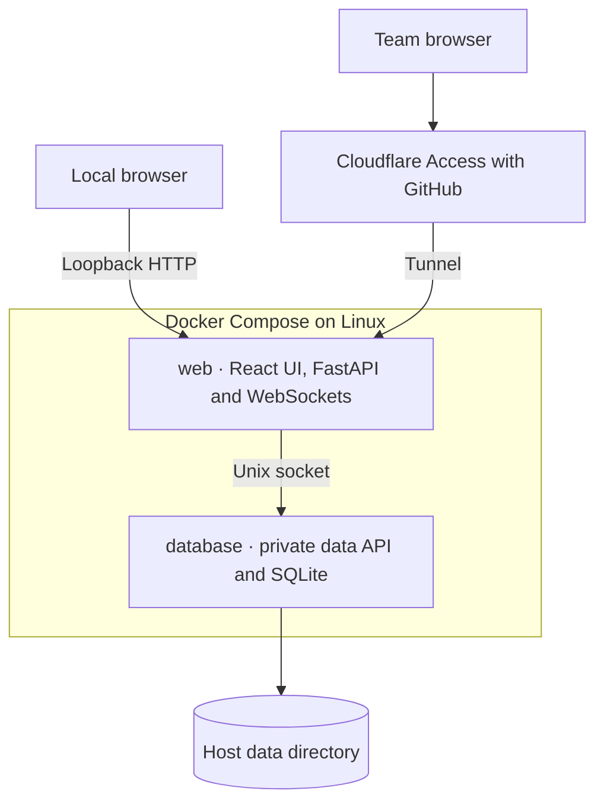

# Flow Canvas Studio

Flow Canvas Studio is a self-hosted flowchart editor for teams. Create workspaces, organize canvases, and copy a canvas into another workspace to explore changes independently. A new database starts with one empty workspace. You can create a blank canvas or import an existing workflow JSON file.

- **Edit a graph.** Connect steps, add decisions, group nodes into frames or subflows, and attach instructions or commands. Export JSON to exchange a workflow or download a standalone HTML copy for offline use.
- **Collaborate on a canvas.** Changes are saved per node or edge and announced to other editors after the database transaction commits. If two people change the same item, the second editor can recover their draft or save it as a separate canvas.
- **Personalize the display.** Theme, reading size and cursor effects follow the signed-in user across workspaces and canvases in the same browser.

## Updating a canvas from JSON

In a workspace, **從 JSON 建立** creates an independent canvas from a workflow file. Inside an existing canvas, open **工具 → 從 JSON 更新** to preview additions, edits and removals. Expand an item to see the team and file values. JSON exported from this canvas over HTTPS or localhost includes its revision and per-item fingerprints. This lets the preview distinguish offline edits from changes made by teammates since export. For older files or files from another canvas, the comparison starts with the canvas you opened for review. Check the listed removals before applying.

Teammates can keep editing during review. Unrelated edits are kept automatically. If a teammate changes the same item or adds a connection to a node marked for deletion, the preview asks you to choose **保留團隊版本** or **採用 JSON**. Related nodes and connections are reviewed together. A new edit to an already reviewed conflict reopens that choice. Apply the finished selection in one transaction.

Every successful update saves the previous graph in SQLite. From **匯入前的版本**, compare a saved version against the current canvas or open it as an independent copy. These versions travel with the database backup.

## Architecture



The **web** container serves the built frontend, verifies the user's identity, and broadcasts canvas updates. The **database** container is the sole owner of the SQLite file and its WAL. It exposes a small data API over a shared Unix socket and has no network interface for external clients. Both services use one worker. The web container binds to the host's loopback interface so local browser authentication and a host-installed Cloudflare Tunnel use the same origin.

| Path | Responsibility |
| --- | --- |
| `frontend/src/catalog/` | Workspace and canvas catalog, creation, renaming and duplication |
| `frontend/src/import/` | JSON file validation, live change comparison, conflict resolution and import history |
| `frontend/src/editor/`, `frontend/src/display/` | Canvas session, draft recovery, graph overview and personal display preferences |
| `frontend/workbench/markup/`, `frontend/workbench/styles/` | Workbench interface fragments and feature stylesheets |
| `frontend/workbench/` | JavaScript modules for graph validation, editing, layout, rendering, import and export |
| `frontend/build/workbench.js` | Assembles the hosted workbench HTML, JavaScript and CSS during the Vite build |
| `backend/main.py` | Public FastAPI entry point, authentication middleware and WebSockets |
| `backend/database_api.py` | Private data API and transaction boundaries |
| `backend/storage.py`, `backend/backup.py` | SQLite schema, graph persistence and online backup |
| `deploy/native/` | Shell scripts to install dependencies, build the frontend and start the native server |
| `deploy/docker/` | Multi-stage Dockerfile, build-context allowlist and Compose configuration |

## Deploy with Docker Compose

Run these commands **from the repo root** on Linux with Docker Engine and the Compose plugin. For Docker Desktop, enable host networking first. [Docker host networking](https://docs.docker.com/engine/network/drivers/host/)

```bash
export FLOW_UID="$(id -u)" FLOW_GID="$(id -g)"
mkdir -p ../flow-canvas-studio-data
docker compose -f deploy/docker/docker-compose.yml up -d --build --wait
docker compose -f deploy/docker/docker-compose.yml ps
```

Open **[Flow Canvas Studio](http://127.0.0.1:8768/)**. Compose defaults to local mode. An existing native installation can use the same database directory, schema and canvas URLs. **Stop the native server before switching to Compose with the same database** so one web process owns the live editing sessions. To test alongside the native server, use a separate directory **and** port. Run this in a separate terminal so the test settings stay isolated:

```bash
export FLOW_DATA_DIR="$(mktemp -d)" FLOW_PORT=8769 COMPOSE_PROJECT_NAME=flow-canvas-preview
export FLOW_UID="$(id -u)" FLOW_GID="$(id -g)"
docker compose -f deploy/docker/docker-compose.yml up -d --build --wait
```

Open [the test instance](http://127.0.0.1:8769/). To read logs or stop the stack:

```bash
docker compose -f deploy/docker/docker-compose.yml logs -f web database
docker compose -f deploy/docker/docker-compose.yml down
```

The default database path is **`../flow-canvas-studio-data/studio.sqlite3`**, outside the repo. For a custom location, set `FLOW_DATA_DIR` to **an existing absolute path** on a local disk and grant the database process read/write access. `FLOW_UID` and `FLOW_GID` select the numeric owner used by the database container and default to `1000:1000`. Compose's named volume carries only the communication socket.

### Enable GitHub sign-in through Cloudflare Access

1. Create a GitHub identity provider in Cloudflare Zero Trust. Use the callback URL supplied by Cloudflare, then enter the OAuth client ID and secret in the identity provider settings.
2. Protect the entire hostname with a self-hosted Access application. Select GitHub as the sole provider, enable instant authentication, and configure an Allow policy for your GitHub organization and team.
3. From the repo root, copy `.env.example` to `.env`. Set `FLOW_AUTH=cloudflare`, `CF_ACCESS_ISSUER`, `CF_ACCESS_AUD` and `FLOW_ORIGIN` to the values for your application. Use your public HTTPS origin for `FLOW_ORIGIN`.
4. Route the hostname through a host-installed Cloudflare Tunnel to `http://127.0.0.1:8768`. Start the stack with the explicit environment file and verify access with an account inside the team and one outside it.

```bash
docker compose --env-file .env -f deploy/docker/docker-compose.yml up -d --build --wait
```

An active Access session opens the site directly. When authentication is required, GitHub handles its session, consent and MFA. The web backend validates the signed Access token for HTTP and WebSocket connections. [GitHub identity provider](https://developers.cloudflare.com/cloudflare-one/integrations/identity-providers/github/) · [Instant authentication](https://developers.cloudflare.com/learning-paths/clientless-access/access-application/create-access-app/) · [Access JWT validation](https://developers.cloudflare.com/cloudflare-one/access-controls/applications/http-apps/authorization-cookie/validating-json/)

## Scheduled backups and recovery

The database service scans on startup and every 15 minutes while running. The first scan records existing items. Subsequent scans compare workspace update times and canvas update times and revisions. Creating or renaming an item, editing its graph, and applying an import are captured at the next scan. Multiple edits between scans produce one point. A workspace point preserves its name and identity. Each canvas has its own timeline including its name, graph and workspace ID.

Open **備份管理** or visit `/admin` to list active points and restore a selected item. The first user to sign in after installing this feature owns the page and management API. In loopback development, a persistent HTTP-only browser cookie identifies the first browser profile. Clearing it removes that browser's access. When switching to Cloudflare Access, the first verified Access login takes ownership from the development profile. Ownership then follows the Access issuer and subject across devices and restarts. Further logins, including local profiles, cannot claim ownership. Host operators retain CLI access.

Restoring B in an A → B → C timeline keeps A and B visible. C and any newer unsnapshotted edits become cold archives. A subsequent edit creates a new point on the active timeline. A canvas restore preserves its ID and advances its live revision so connected editors can synchronize. A workspace restore changes only its name. If the item changes during confirmation, refresh and review the restore again.

Active points expire seven days after capture. Cold points expire seven days after archiving. Expired points are hidden immediately and their files are collected on the next scan. An idle item can have no retained point after seven days. Each archive is an independent gzip file under `FLOW_DATA_DIR/backups/`; the SQLite database tracks which points are active. Cold files keep their gzip payload and are available to the host operator.

Run these native commands from the repository root with the same `FLOW_DATA_DIR` as the service:

```bash
.venv/bin/python -m backend.recovery list
.venv/bin/python -m backend.recovery list --cold
.venv/bin/python -m backend.recovery restore --canvas CANVAS_ID --at '2026-11-24T09:30:00+08:00'
.venv/bin/python -m backend.recovery restore --id BACKUP_ID
```

Time-based restore selects the latest retained active point for that canvas at or before the supplied time. Include a timezone offset. The CLI applies the restore immediately. An already-open canvas receives CLI changes at its next revision check (within about 25 seconds on an idle connection). Use `scan` to run the regular change check on demand. In Compose, run the same module inside the database container:

```bash
docker compose -f deploy/docker/docker-compose.yml exec -T database python -m backend.recovery list
docker compose -f deploy/docker/docker-compose.yml exec -T database python -m backend.recovery restore --id BACKUP_ID
```

For an independent copy of a cold canvas, use the filename from `list --cold`. Extract its graph and use **從 JSON 建立** in a workspace:

```bash
gzip -dc "/path/to/data/backups/ARCHIVE.json.gz" | jq '.graph' > recovered-canvas.json
```

## Back up or move to another machine

Create a consistent online snapshot from the database container. It includes committed WAL changes and preserves workspace IDs, canvas IDs, revisions and imported assets.

```bash
snapshot="backup-$(date +%Y%m%d-%H%M%S).sqlite3"
docker compose -f deploy/docker/docker-compose.yml exec -T database \
  python -m backend.backup "/data/$snapshot"
```

The snapshot appears in the host data directory. For a complete migration, stop the services and copy the **entire data directory**, including `backups/` and any SQLite sidecars, separately from the repo. On the destination, point `FLOW_DATA_DIR` at that directory and start Compose. Restore the Access and Tunnel configuration separately if using a public hostname.

For a database-only migration, pause editing and take a final online snapshot with the command above. Copy it into a fresh data directory as `studio.sqlite3`. This preserves the current canvases, owners and backup catalog. Restoring a historical catalog entry also requires its corresponding gzip file. Keep an off-machine copy of the data directory to recover from loss of the host disk.

## Native development

Requires Python 3.12 with uv or venv/pip, and Node.js 22.12+ or 24. Native mode runs the same database API in-process. The default data path matches the Compose deployment.

```bash
./deploy/native/setup.sh
./deploy/native/start.sh --local
```

For Cloudflare mode, configure the repo-root `.env` and run `./deploy/native/start.sh`. To back up a native instance, run `.venv/bin/python -m backend.backup /path/to/new-backup.sqlite3` with the same `FLOW_DATA_DIR` as the server.

To rebuild after frontend changes, run `npm run build` in `frontend/`. The server serves the result from `frontend/dist/`. The hosted editor loads separate JavaScript and CSS files. Downloading a canvas embeds its graph, runtime and stylesheet in one HTML file that can reopen and be edited offline.

## Verification

```bash
.venv/bin/python -m unittest discover -s tests -v
(cd frontend && npm run build)
docker compose -f deploy/docker/docker-compose.yml config --quiet
```

The backend suite covers the private service boundary, database outages, concurrent edits, conflicts, rollback, canvas duplication, backup/restore and Access authentication. Set `FLOW_TEST_GRAPH` to an external workflow JSON to include the full import/export round-trip check. To exercise two independent browser sessions against a temporary database:

```bash
cd frontend
npx playwright install chromium
npm run test:browser
```

For an installed Chrome browser, use `CHROME_BIN=/usr/bin/google-chrome npm run test:browser`.
