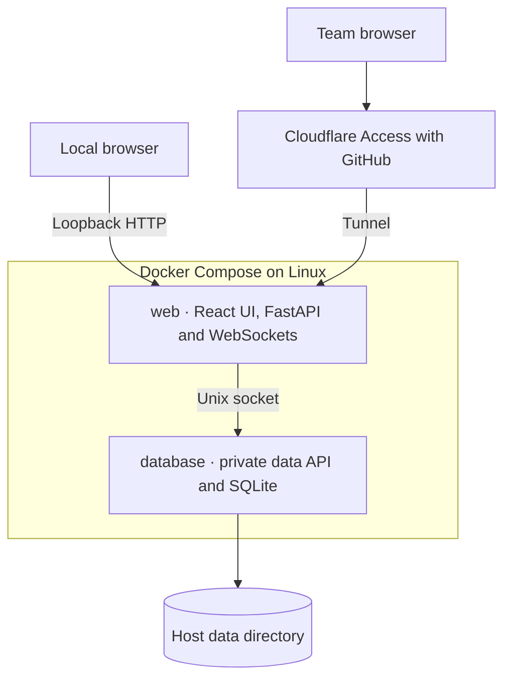

# Flow Canvas Studio

Flow Canvas Studio is a self-hosted flowchart editor for teams. Create workspaces, organize canvases, and copy a canvas into another workspace to explore changes independently. A new database starts with one empty workspace. You can create a blank canvas or import an existing workflow JSON file.

- **Edit a graph.** Connect steps, add decisions, group nodes into frames or subflows, and attach instructions or commands. Export JSON to exchange a workflow or download a standalone HTML copy for offline use.
- **Collaborate on a canvas.** Changes are saved per node or edge and announced to other editors after the database transaction commits. If two people change the same item, the second editor can recover their draft or save it as a separate canvas.
- **Personalize the display.** Theme, reading size and cursor effects follow the signed-in user across workspaces and canvases in the same browser.

## Architecture



The **web** container serves the built frontend, verifies the user's identity, and broadcasts canvas updates. The **database** container is the sole owner of the SQLite file and its WAL. It exposes a small data API over a shared Unix socket and has no network interface for external clients. Both services use one worker. The web container binds to the host's loopback interface so local browser authentication and a host-installed Cloudflare Tunnel use the same origin.

| Path | Responsibility |
| --- | --- |
| `frontend/` | React and TypeScript UI, flow editor, browser tests |
| `backend/main.py` | Public FastAPI entry point, authentication middleware and WebSockets |
| `backend/database_api.py` | Private data API and transaction boundaries |
| `backend/storage.py`, `backend/backup.py` | SQLite schema, graph persistence and online backup |
| `deploy/native/` | Shell scripts to install dependencies, build the frontend and start the native server |
| `deploy/docker/` | Multi-stage Dockerfile, build-context allowlist and Compose configuration |

## Deploy with Docker Compose

Run these commands **from the repo root** on Linux with Docker Engine and the Compose plugin. For Docker Desktop, enable host networking first. [Docker host networking](https://docs.docker.com/engine/network/drivers/host/)

```bash
export FLOW_UID="$(id -u)" FLOW_GID="$(id -g)"
mkdir -p ../flow-canvas-studio-data
docker compose -f deploy/docker/docker-compose.yml up -d --build --wait
docker compose -f deploy/docker/docker-compose.yml ps
```

Open **[Flow Canvas Studio](http://127.0.0.1:8768/)**. Compose defaults to local mode. An existing native installation can use the same database directory, schema and canvas URLs. **Stop the native server before switching to Compose with the same database** so one web process owns the live editing sessions. To test alongside the native server, use a separate directory **and** port. Run this in a separate terminal so the test settings stay isolated:

```bash
export FLOW_DATA_DIR="$(mktemp -d)" FLOW_PORT=8769 COMPOSE_PROJECT_NAME=flow-canvas-preview
export FLOW_UID="$(id -u)" FLOW_GID="$(id -g)"
docker compose -f deploy/docker/docker-compose.yml up -d --build --wait
```

Open [the test instance](http://127.0.0.1:8769/). To read logs or stop the stack:

```bash
docker compose -f deploy/docker/docker-compose.yml logs -f web database
docker compose -f deploy/docker/docker-compose.yml down
```

The default database path is **`../flow-canvas-studio-data/studio.sqlite3`**, outside the repo. For a custom location, set `FLOW_DATA_DIR` to **an existing absolute path** on a local disk and grant the database process read/write access. `FLOW_UID` and `FLOW_GID` select the numeric owner used by the database container and default to `1000:1000`. Compose's named volume carries only the communication socket.

### Enable GitHub sign-in through Cloudflare Access

1. Create a GitHub identity provider in Cloudflare Zero Trust. Use the callback URL supplied by Cloudflare, then enter the OAuth client ID and secret in the identity provider settings.
2. Protect the entire hostname with a self-hosted Access application. Select GitHub as the sole provider, enable instant authentication, and configure an Allow policy for your GitHub organization and team.
3. From the repo root, copy `.env.example` to `.env`. Set `FLOW_AUTH=cloudflare`, `CF_ACCESS_ISSUER`, `CF_ACCESS_AUD` and `FLOW_ORIGIN` to the values for your application. Use your public HTTPS origin for `FLOW_ORIGIN`.
4. Route the hostname through a host-installed Cloudflare Tunnel to `http://127.0.0.1:8768`. Start the stack with the explicit environment file and verify access with an account inside the team and one outside it.

```bash
docker compose --env-file .env -f deploy/docker/docker-compose.yml up -d --build --wait
```

An active Access session opens the site directly. When authentication is required, GitHub handles its session, consent and MFA. The web backend validates the signed Access token for HTTP and WebSocket connections. [GitHub identity provider](https://developers.cloudflare.com/cloudflare-one/integrations/identity-providers/github/) · [Instant authentication](https://developers.cloudflare.com/learning-paths/clientless-access/access-application/create-access-app/) · [Access JWT validation](https://developers.cloudflare.com/cloudflare-one/access-controls/applications/http-apps/authorization-cookie/validating-json/)

## Back up or move to another machine

Create a consistent online snapshot from the database container. It includes committed WAL changes and preserves workspace IDs, canvas IDs, revisions and imported assets.

```bash
snapshot="backup-$(date +%Y%m%d-%H%M%S).sqlite3"
docker compose -f deploy/docker/docker-compose.yml exec -T database \
  python -m backend.backup "/data/$snapshot"
```

The snapshot appears in the host data directory. To migrate, pause editing, take a final snapshot, and copy **the repo and snapshot separately**. On the new machine, create a **fresh** data directory, copy the snapshot into it as `studio.sqlite3`, set `FLOW_DATA_DIR` to its absolute path, and run the Compose deployment commands. Restore the Access and Tunnel configuration separately if using a public hostname. When copying a live database, use the backup command so pending WAL data travels with the snapshot.

## Native development

Requires Python 3.12 with uv or venv/pip, and Node.js 22.12+ or 24. Native mode runs the same database API in-process. The default data path matches the Compose deployment.

```bash
./deploy/native/setup.sh
./deploy/native/start.sh --local
```

For Cloudflare mode, configure the repo-root `.env` and run `./deploy/native/start.sh`. To back up a native instance, run `.venv/bin/python -m backend.backup /path/to/new-backup.sqlite3` with the same `FLOW_DATA_DIR` as the server.

## Verification

```bash
.venv/bin/python -m unittest discover -s tests -v
(cd frontend && npm run build)
docker compose -f deploy/docker/docker-compose.yml config --quiet
```

The backend suite covers the private service boundary, database outages, concurrent edits, conflicts, rollback, canvas duplication, backup/restore and Access authentication. Set `FLOW_TEST_GRAPH` to an external workflow JSON to include the full import/export round-trip check. To exercise two independent browser sessions against a temporary database:

```bash
cd frontend
npx playwright install chromium
npm run test:browser
```

For an installed Chrome browser, use `CHROME_BIN=/usr/bin/google-chrome npm run test:browser`.
