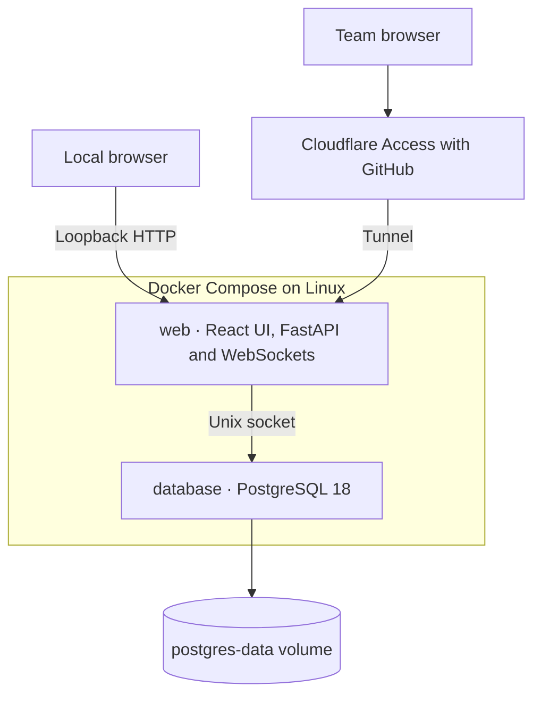

# Flow Canvas Studio

Flow Canvas Studio is a self-hosted flowchart editor for teams. Create workspaces, organize canvases, and copy a canvas into another workspace to explore changes independently. A new database starts with one empty workspace. You can create a blank canvas or import an existing workflow JSON file.

- **Edit a graph.** Connect steps, add decisions, group nodes into frames or subflows, and attach instructions or commands. Export JSON to exchange a workflow or download a standalone HTML copy for offline use.
- **Collaborate on a canvas.** Changes are saved per node or edge and announced to other editors after the database transaction commits. If two people change the same item, the second editor can recover their draft or save it as a separate canvas.
- **Personalize the display.** Theme, reading size and cursor effects follow the signed-in user across workspaces and canvases in the same browser.

For a new installation, start with [Docker deployment](#deploy-with-docker-compose). If you already have a `studio.sqlite3` file, follow [the SQLite upgrade procedure](#upgrade-an-existing-sqlite-installation) before starting the new web service. To move an existing PostgreSQL installation, use [backup and restore](#back-up-or-move-to-another-machine).

## Working with canvases

The workspace catalog supports search by canvas name, sorting by name or last edit, pagination, and grid or list view. Open **節點總覽** inside a canvas to find a step, or use the workbench search to locate a node by ID, title or content. The graph supports up to 300 nodes and 800 connections per canvas.

Collapse a branch with **−** and expand its descendants with **＋**. Nodes reachable through other visible paths stay on screen. Use **拖拉編輯** to position nodes on the grid. To move several nodes together, enable **框選** or hold Shift and drag from empty canvas space around the nodes. Drag any selected node to move the group. Undo restores all positions in one step. Click empty space or press Escape to clear the selection. Canvas and group styles supply defaults for new nodes, and individual nodes can override them. In the node editor, choose or create a reusable **醒目標籤** to mark a step. Set its color, style and icon, then drag it above or below the node.

### Node IDs and assignments

The node form suggests the first available number for its type, such as `STEP1`, `DEC1` or `FRAME1`. You can enter your own ID before creating the node. If another editor claims it first, open the draft comparison and confirm the suggested replacement to keep both nodes and their connections.

Choose **返回節點** in the node form and search for a destination. The return target and incoming/outgoing connection pickers show `type | ID · title`, so identically named nodes are distinguishable. Click a return node once to select and edit it. Double-click it to center the destination and open its details, or use the jump button in the inspector.

In **拖拉編輯**, drag a wire segment to move its lane or drag its label to reposition the text. Select the wire to reveal its round start handle and square end handle. Drag either handle along a node side to choose its exact attachment point. Drag the handle or the segment touching the node close to another wire on the same side to share its attachment point. The connection editor also offers side selectors and a reset to automatic routing. Drag a vertical segment sideways to set the turn distance, then drag a horizontal segment up or down to set its height. The other bends stay in place when you adjust either segment. Drag close to an aligned port to snap the segment back in line. Nearby parallel segments on other visible wires also act as guides. Drag within six screen pixels to align overlapping or adjoining segments, and drag farther away to separate them. Each completed drag is one undoable edit.

Each canvas has reusable owner and location options. The dropdowns include values already used by imported nodes. Add an option in the node form and apply the form to share it with other editors. Use **自訂欄位** for text, numeric or choice fields and **角色泳道** to view assignments by role.

## Canvas activity

The activity panel keeps up to 200 summaries per active canvas. Consecutive routine saves by the same editor within a five-minute clock interval share a summary, with up to 12 detailed items. Node additions and deletions, canvas renames, imports and restores start separate entries. Each graph transaction still advances its own revision for conflict detection. The activity limit applies to the display history independently of backup retention.

## Updating a canvas from JSON

In a workspace, **從 JSON 建立** creates an independent canvas from a workflow file. Inside an existing canvas, open **工具 → 從 JSON 更新** to preview additions, edits and removals. Expand an item to see the team and file values. JSON exported from this canvas over HTTPS or localhost includes its revision and per-item fingerprints. This lets the preview distinguish offline edits from changes made by teammates since export. For older files or files from another canvas, the comparison starts with the canvas you opened for review. Check the listed removals before applying.

Teammates can keep editing during review. Unrelated edits are kept automatically. If a teammate changes the same item or adds a connection to a node marked for deletion, the preview asks you to choose **保留團隊版本** or **採用 JSON**. Related nodes and connections are reviewed together. A new edit to an already reviewed conflict reopens that choice. Apply the finished selection in one transaction.

Every successful update saves the previous graph in PostgreSQL. From **匯入前的版本**, compare a saved version against the current canvas or open it as an independent copy. These versions travel with the database backup.

## Architecture



The **web** container serves the UI, verifies identities, runs the private data API and broadcasts committed edits. The **database** container runs PostgreSQL 18 with a dedicated data volume and a Unix socket shared only with the app. The web process binds to host loopback for local sign-in and Cloudflare Tunnel. Keep one web worker for in-memory presence and immediate WebSocket notifications. PostgreSQL has no published TCP port.

| Path | Responsibility |
| --- | --- |
| `frontend/src/catalog/` | Workspace and canvas catalog, creation, renaming and duplication |
| `frontend/src/import/` | JSON file validation, live change comparison, conflict resolution and import history |
| `frontend/src/editor/`, `frontend/src/display/` | Canvas session, draft recovery, graph overview and personal display preferences |
| `frontend/workbench/markup/`, `frontend/workbench/styles/` | Workbench interface fragments and feature stylesheets |
| `frontend/workbench/` | JavaScript modules for graph validation, editing, layout, rendering, import and export |
| `frontend/build/workbench.js` | Assembles the hosted workbench HTML, JavaScript and CSS during the Vite build |
| `backend/main.py` | Public FastAPI entry point, authentication middleware and WebSockets |
| `backend/database_api.py` | Private data API and transaction boundaries |
| `backend/storage.py`, `backend/postgres.py` | Graph persistence, transactions and schema initialization |
| `backend/snapshots.py`, `backend/recovery.py` | Scheduled recovery points and the operator CLI |
| `backend/bundle.py`, `backend/migrate_sqlite.py` | Portable ZIP exchange and explicit SQLite conversion |
| `frontend/src/knowledge/`, `frontend/src/admin/` | Knowledge articles and sharing, backup search and restore |
| `backend/migrations/` | Numbered SQL migrations applied transactionally during startup |
| `deploy/native/` | Shell scripts to install dependencies, build the frontend and start the native server |
| `deploy/docker/` | Multi-stage Dockerfile, build-context allowlist and Compose configuration |

## Configure authentication with `FLOW_AUTH`

Choose the mode in the repo-root `.env`. Run the deployment commands from that directory.

| Mode | When to use it | How to verify |
| --- | --- | --- |
| `local` | Development in a browser on the same host. The backend accepts direct loopback requests and rejects forwarded requests. | Open `http://127.0.0.1:8768/api/session` in your browser and check for `"mode": "local"`. |
| `cloudflare` | Team access through a public HTTPS hostname protected by Cloudflare Access with GitHub. | Open `/api/session` on the public hostname after sign-in and check for `"mode": "cloudflare"` and your GitHub `username`. |

**Local development.** Set one authentication variable in `.env`.

```dotenv
FLOW_AUTH=local
```

**Cloudflare with GitHub.** Start from `.env.example` and replace the three placeholders with your deployment values.

```dotenv
FLOW_AUTH=cloudflare
CF_ACCESS_ISSUER=https://your-team.cloudflareaccess.com
CF_ACCESS_AUD=your-application-audience-tag
FLOW_ORIGIN=https://flow.example.com
```

`CF_ACCESS_ISSUER` is your Zero Trust team URL. Copy `CF_ACCESS_AUD` from the existing Access application that protects the site. Set `FLOW_ORIGIN` to the exact public HTTPS origin users open, including a nonstandard port if applicable, with no path. For Tunnel routing and first-admin setup, see [Enable GitHub sign-in through Cloudflare Access](#enable-github-sign-in-through-cloudflare-access).

**Apply a mode change.** On an existing Docker deployment, run the following after editing `.env`. If you previously exported `FLOW_AUTH` in this shell, run `unset FLOW_AUTH` first so Compose uses the file's value.

```bash
docker compose --env-file .env -f deploy/docker/docker-compose.yml up -d --wait web
```

For a native deployment, stop the running server and run `./deploy/native/start.sh` to reload `.env`. The `--local` flag overrides the file for one run. With `FLOW_AUTH` unset, Compose defaults to `local` and the native backend defaults to `cloudflare`. The supplied `.env.example` explicitly selects `cloudflare`.

## Deploy with Docker Compose

Run commands from the repo root on Linux with Docker Engine and the Compose plugin. The web service uses host networking. For Docker Desktop, enable host networking first. [Docker host networking](https://docs.docker.com/engine/network/drivers/host/)

### Start a new local installation

Use an empty source directory for a blank site. The default path is a sibling of the repository. Compose requires the directory to exist, even when there is nothing to import. If it already contains a legacy database, use the upgrade instructions below.

```bash
mkdir -p ../flow-canvas-studio-data
export FLOW_DATA_DIR="$(realpath ../flow-canvas-studio-data)"
export FLOW_UID="$(id -u)" FLOW_GID="$(id -g)"
FLOW_AUTH=local docker compose -f deploy/docker/docker-compose.yml up -d --build --wait
curl --fail --silent --show-error "http://127.0.0.1:${FLOW_PORT:-8768}/healthz"
```

With the default port, expect `{"ready":true}`. Open [Flow Canvas Studio](http://127.0.0.1:8768/) to see the initial empty workspace. Set `FLOW_AUTH=local` in the repo-root `.env` to keep this mode across future deployments. See [Cloudflare sign-in](#enable-github-sign-in-through-cloudflare-access) for a team installation.

| Setting | Purpose |
| --- | --- |
| `FLOW_DATA_DIR` | Existing host directory mounted read-only at `/legacy`. The first initialization looks here for `studio.sqlite3` and its indexed gzip archives. |
| `FLOW_PGDATA` | Live PostgreSQL storage. Defaults to the Compose named volume `postgres-data`. To use a bind mount, set an absolute path to a dedicated PostgreSQL directory before first boot. |
| `COMPOSE_PROJECT_NAME` | Defaults to `flow-canvas-studio`. With named volumes, the project name determines which database the app opens. |
| `FLOW_UID`, `FLOW_GID` | Numeric identity of the web process (defaults to `1000:1000`). It needs read access to the legacy source and write access to any mounted export destination. |
| `FLOW_PORT` | Host loopback port for the web service, default `8768`. Use the same port for health probes and the Tunnel origin. |

Both containers use `restart: unless-stopped`. With Docker configured to start at boot, running services return after a host restart. Keep the project name and data mount stable across updates. Ordinary `docker compose down` preserves the named volumes. Adding `-v` deletes them.

### Upgrade an existing SQLite installation

The converter supports Flow Canvas Studio SQLite schema versions **1 through 8**. It preserves workspace and canvas IDs, graph and item revisions, import and activity history, shared knowledge, administrator ownership, and indexed active and cold recovery points. Canvas URLs continue to use their original IDs.

1. Pause editing and stop the **old** services with their original Compose configuration. Keep a verified backup of the entire source directory, including `studio.sqlite3`, any WAL or journal sidecars, and `backups/`. The source directory can have any name.
2. From the **new** checkout, set `FLOW_DATA_DIR` to that directory's absolute path and select a fresh PostgreSQL destination. Keep those settings in the deployment's `.env` for future starts. Use a separate project name and free port for a rehearsal. If using a PostgreSQL bind mount, select a separate directory as well.
3. Check the source and perform the one-time conversion. The source check needs Python 3 with SQLite support. The migration script builds the web image, starts the database, and runs the converter without starting the web server.

```bash
export FLOW_DATA_DIR=/absolute/path/to/flow-studio-data
export FLOW_UID="$(id -u)" FLOW_GID="$(id -g)"
python3 -m backend.migrate_sqlite check "$FLOW_DATA_DIR" &&
  ./deploy/docker/migrate-sqlite.sh "$FLOW_DATA_DIR" &&
  docker compose -f deploy/docker/docker-compose.yml up -d --wait web
```

4. Compare the reported row and archive counts, open a known canvas by its original URL, and check recovery points before reopening editing. Before new edits are accepted, you can roll back by stopping the PostgreSQL deployment and starting the old version with its original directory. To carry subsequent edits back to a compatible SQLite release, create a new portable bundle.

The converter upgrades a private copy of SQLite, validates its integrity and indexed archives, and compares row and archive counts before committing. A failure rolls back the PostgreSQL transaction. Fix the source or permissions and retry. An initialized destination, including one containing only the default workspace, causes the explicit migration to stop. Use a fresh target to keep both installations.

**Automatic first boot** is an alternative to step 3. With the same source and a fresh PostgreSQL destination, `docker compose -f deploy/docker/docker-compose.yml up -d --build --wait` imports the legacy data as part of web startup. If the source directory exists but contains no `studio.sqlite3`, automatic startup creates a blank workspace. Later starts retain the existing PostgreSQL records and skip the SQLite import.

### Update an existing PostgreSQL installation

After updating the deployed checkout, reuse the existing `.env`, Compose project name and PostgreSQL volume. The web service applies pending [numbered SQL migrations](backend/migrations/) in order under a database lock and records each applied version in `schema_migrations`. This procedure covers application schema updates within PostgreSQL 18.

```bash
docker compose -f deploy/docker/docker-compose.yml up -d --build --wait
docker compose -f deploy/docker/docker-compose.yml exec -T database \
  psql -U flow_app -d flow -c 'SELECT version, applied_at FROM schema_migrations ORDER BY version'
```

### Enable GitHub sign-in through Cloudflare Access

**1. Configure GitHub and Access.** If your Zero Trust account already has a working GitHub identity provider, reuse it. Otherwise, register an OAuth App in GitHub under **Settings → Developer settings → OAuth Apps**. Set its homepage to `https://TEAM.cloudflareaccess.com` and its authorization callback to `https://TEAM.cloudflareaccess.com/cdn-cgi/access/callback`. In **Zero Trust → Integrations → Identity providers**, add GitHub, enter the client ID and secret, then finish authorization and test the provider. The OAuth secret belongs in Cloudflare. [GitHub identity provider setup](https://developers.cloudflare.com/cloudflare-one/integrations/identity-providers/github/)

Use an existing **Self-hosted** Access application or create one covering the whole public hostname (for example, `flow.example.com`, with the path empty). Select GitHub as its only login method and enable **Apply instant authentication**. Add an **Allow** policy with an **Include → GitHub Organization** rule and select the intended organization and team. For a new deployment, temporarily add **Require → Emails** for the intended first administrator in that same policy. Copy the application's **Audience (AUD) Tag**. [Access application settings](https://developers.cloudflare.com/learning-paths/clientless-access/access-application/create-access-app/)

**2. Start the app on the remote Linux server.** From the root of this version of the repo, create the host data directory and edit the environment file. Keep an existing data directory and its ownership when migrating an installation.

```bash
install -d -m 700 ../flow-canvas-studio-data
test -f .env || install -m 600 .env.example .env
nano .env
```

Enter the four settings from [Configure authentication with `FLOW_AUTH`](#configure-authentication-with-flow_auth) for Cloudflare mode. `FLOW_PORT` defaults to `8768` and controls the loopback port used by the Tunnel.

```bash
export FLOW_UID="$(id -u)" FLOW_GID="$(id -g)"
docker compose --env-file .env -f deploy/docker/docker-compose.yml up -d --build --wait
docker compose --env-file .env -f deploy/docker/docker-compose.yml ps
curl -s -o /dev/null -w '%{http_code}\n' http://127.0.0.1:8768/api/session
```

Both services should be healthy. The loopback probe should return **401** because it has no Access credential. For an existing data directory with a different owner, set `FLOW_UID` and `FLOW_GID` to its numeric owner and group instead. The web service needs outbound HTTPS to the team domain and `api.github.com`.

**3. Connect the hostname.** In **Networking → Tunnels**, select a healthy tunnel running on this server. Add a **Published application** route with the same hostname as the Access application, type **HTTP**, and service URL **127.0.0.1:8768**. A host-installed connector can reach this loopback address directly. If creating a new tunnel, use its dashboard installation instructions on the server. For a new Docker-based connector on Linux, you can instead run the following in Bash with the new tunnel's token. Host networking lets this connector reach the web service. [Tunnel setup](https://developers.cloudflare.com/tunnel/get-started/) · [Tunnel token file](https://developers.cloudflare.com/tunnel/reference/run-parameters/)

```bash
install -d -m 700 "$HOME/.config/flow-tunnel"
(umask 077
 read -rsp 'Tunnel token: ' flow_tunnel_token && echo &&
 printf '%s' "$flow_tunnel_token" > "$HOME/.config/flow-tunnel/token")
docker run -d --name flow-cloudflared --restart unless-stopped --network host \
  --user "$(id -u):$(id -g)" \
  --mount "type=bind,source=$HOME/.config/flow-tunnel/token,target=/run/tunnel-token,readonly" \
  cloudflare/cloudflared:latest tunnel --no-autoupdate run --token-file /run/tunnel-token
```

**4. Verify sign-in and open the team policy.** Open the public hostname with the intended administrator's GitHub browser session. The first verified Cloudflare login on a fresh or local-only database claims `/admin`. Visit `/api/session` on the public site and confirm `mode` is `cloudflare`, `username` matches your GitHub handle, and `admin` is `true`. Remove the temporary **Require → Emails** rule after confirming ownership. An allowed teammate should see their own handle and receive **403** on `/admin`. Test the public hostname with an account outside the team to verify Cloudflare denies access.

An active Access session opens the app directly. When the session expires, GitHub handles sign-in, consent and MFA. The app verifies the Access assertion on HTTP and WebSocket requests, then uses that assertion to read the signed-in user's identity from the team domain. For a GitHub identity with a numeric upstream account ID, the web service fetches the current GitHub `login` by ID. It also accepts an explicit GitHub `login` in the identity response. Successful lookups are cached for up to 15 minutes and expire with the assertion. The new handle appears in the workspace header and on newly attributed edits and imports. Existing author records, per-user browser preferences, drafts and administrator ownership retain their original identifiers. [Access identity response](https://developers.cloudflare.com/cloudflare-one/access-controls/applications/http-apps/authorization-cookie/application-token/) · [GitHub user lookup by ID](https://docs.github.com/en/rest/users/users#get-a-user-using-their-id)

If Access omits both the GitHub ID and login, an operator can set `FLOW_GITHUB_ID_MAP='{"access-user-uuid":12345}'` in the private server `.env`. Obtain the user's `user_uuid` from the authenticated site's `/cdn-cgi/access/get-identity` and confirm their GitHub account ID using `gh api users/HANDLE --jq .id`. Use a verified account pairing. This optional mapping only supplies the display identity after Access admits a GitHub user. For a private Enterprise Managed User, set `FLOW_GITHUB_API_TOKEN` to a credential that can read that account. Public profiles normally work without a token. Rerun the Compose `up -d` command after changing the environment. Keep the environment file and tunnel token outside version control.

## Scheduled backups and recovery

The web service scans on startup and every 15 minutes while running. The first scan records existing items. Subsequent scans compare workspace update times and canvas update times and revisions. Creating or renaming an item, editing its graph, and applying an import are captured at the next scan. Multiple edits between scans produce one point. A workspace point preserves its identity, name, knowledge entries and sharing settings. Each canvas has its own timeline including its name, graph and workspace ID.

Use the trash button on a canvas card to remove it from its workspace. **工具 → 清空畫布** resets the graph and keeps the canvas in place. Both operations check the displayed revision and save a recovery point before changing data. An administrator can restore the content within seven days, including a deleted canvas at its original URL.

Open **備份管理** or visit `/admin` to page through active points and restore a selected item. Search by workspace or canvas name or backup ID, and filter by workspace, canvas or backup type. The first authenticated browser to open the app completes a session login and owns the page and management API. The browser sends `POST /api/session/login` automatically. HTTP GET requests to the homepage, the admin shell, or `/api/session` do not register an owner. Monitor the minimal `GET /healthz` endpoint for web and database readiness (200 or 503). In loopback development, a persistent HTTP-only browser cookie identifies the first browser profile. Clearing it removes that browser's access. When switching to Cloudflare Access, the first verified Access login takes ownership from the development profile. Ownership then follows the Access issuer and subject across devices and restarts. Further logins, including local profiles, cannot claim ownership. Host operators retain CLI access.

The admin page displays the last scheduled attempt, last successful and failed checks, failure reason, and number of snapshots actually committed in the current or last run. A successful check with zero changes is visible. The status survives restarts. The page refreshes every minute and flags attempts older than 20 minutes. Manual CLI scans do not change scheduled health.

Restoring B in an A → B → C timeline keeps A and B visible. C and any newer unsnapshotted edits become cold archives. A subsequent edit creates a new point on the active timeline. A canvas restore preserves its ID and advances its live revision so connected editors can synchronize. A workspace restore applies its saved name and, when the snapshot includes a knowledge library, restores the entries and their sharing settings. Linked canvases can receive those knowledge changes. Each canvas graph has its own restore point. If the item changes during confirmation, refresh and review the restore again.

Active points expire seven days after capture. Cold points expire seven days after archiving. Expired points disappear from listings immediately and the next scan removes them from PostgreSQL. An idle item can have no retained point after seven days. PostgreSQL stores the immutable gzip bytes alongside the recovery catalog in the same transaction. Expiry deletes the bytes together with the catalog entry. Operators can export cold points by ID.

Run these native commands from the repository root with the same PostgreSQL connection settings as the service:

```bash
.venv/bin/python -m backend.recovery list
.venv/bin/python -m backend.recovery list --cold
.venv/bin/python -m backend.recovery restore --canvas CANVAS_ID --at '2026-11-24T09:30:00+08:00'
.venv/bin/python -m backend.recovery restore --id BACKUP_ID
```

Time-based restore selects the latest retained active point for that canvas at or before the supplied time. Include a timezone offset. The CLI applies the restore immediately. An already-open canvas receives CLI changes at its next revision check (within about 25 seconds on an idle connection). Use `scan` to run the regular change check on demand. In Compose, run the same module inside the web container:

```bash
docker compose -f deploy/docker/docker-compose.yml exec -T web python -m backend.recovery list
docker compose -f deploy/docker/docker-compose.yml exec -T web python -m backend.recovery restore --id BACKUP_ID
```

To download a retained cold canvas, take its ID from `list --cold` and extract the graph.

```bash
docker compose -f deploy/docker/docker-compose.yml exec -T web python -m backend.recovery export-gzip --id BACKUP_ID > point.json.gz
gzip -dc point.json.gz | jq '.graph' > recovered-canvas.json
```

## Back up or move to another machine

A PostgreSQL custom-format dump includes graph records, versions, operation receipts, admin ownership, shared knowledge, and active and cold recovery payloads. Create it outside the repo. Use a fresh Compose project or empty database on the destination.

```bash
docker compose -f deploy/docker/docker-compose.yml exec -T -u postgres database pg_dump -d flow -Fc > ../flow.dump
```

On the destination, copy `flow.dump` to the repo's parent directory. Start only the database, restore the dump, then start the web service. The example creates the default legacy mount required by Compose.

```bash
mkdir -p ../flow-canvas-studio-data
docker compose -f deploy/docker/docker-compose.yml up -d --wait database
docker compose -f deploy/docker/docker-compose.yml exec -T -u postgres database pg_restore --exit-on-error --single-transaction -d flow < ../flow.dump && \
  docker compose -f deploy/docker/docker-compose.yml up -d --build --wait web
```

The format-1 ZIP remains available for moving between PostgreSQL and older versions of Flow Canvas Studio. Create and verify the bundle on the source machine. Set `archive_dir` outside the repo and choose a new filename for each backup.

```bash
mkdir -p ../flow-archives
archive_dir="$(realpath ../flow-archives)"
docker compose -f deploy/docker/docker-compose.yml run --rm --no-deps -v "$archive_dir:/export" web python -m backend.bundle create /export/flow.zip
docker compose -f deploy/docker/docker-compose.yml run --rm --no-deps -v "$archive_dir:/export:ro" web python -m backend.bundle verify /export/flow.zip
```

On the destination, copy `flow.zip` to `../flow-archives/`, unpack into a new directory, point `FLOW_DATA_DIR` at it and start with a fresh PostgreSQL volume. Bundle verification checks file hashes, gzip integrity, the portable SQLite file and the recovery catalog. The migration preserves IDs, revisions, edit history, insertion order and original expiry dates. Keep the deployment environment and tunnel configuration separately.

```bash
archive_dir="$(realpath ../flow-archives)"
export FLOW_UID="$(id -u)" FLOW_GID="$(id -g)"
docker compose -f deploy/docker/docker-compose.yml build web
FLOW_DATA_DIR="$archive_dir" docker compose -f deploy/docker/docker-compose.yml run --rm --no-deps -v "$archive_dir:/export" web python -m backend.bundle restore /export/flow.zip /export/restored && \
  export FLOW_DATA_DIR="$archive_dir/restored" && \
  ./deploy/docker/migrate-sqlite.sh "$FLOW_DATA_DIR" && \
  docker compose -f deploy/docker/docker-compose.yml up -d --wait web
```

## Collaborative editing

A writer locks its canvas row before checking revisions and operation receipts. Edits on different canvases can commit independently. Concurrent changes to different nodes on the same canvas are checked per record. A stale edit to the same node returns a conflict, and a stale whole-canvas import requires another review. Readers get a consistent graph snapshot while an import is in progress. Live graph records and shared documents use JSONB. Explicit record positions preserve node and edge order. Pre-import graphs use PostgreSQL JSON to retain the original order of their node dictionaries.

Each saved edit batch carries an operation ID. If a response is lost, retrying the same batch returns its original committed revision, including after a restart. Receipts contain the request digest and revision and are stored with the canvas data. A changed payload must use a new operation ID.

Opening an existing node form announces that node over the canvas's existing WebSocket. Editors of the same node see each other's verified display names. Closing the form, switching nodes, or disconnecting clears the hint. Presence lives in memory and does not acquire an edit lock.

## Native development

Requires Python 3.12, Node.js 22.12+ or 24, and a PostgreSQL 18 database owned by the application role. For a native PostgreSQL install, export `FLOW_DATABASE_URL` (a libpq connection string) or set `PGHOST`, `PGUSER`, `PGDATABASE` and any required credentials. For automatic SQLite conversion on first startup, set `FLOW_LEGACY_DIR` to the source directory. To run it explicitly before starting the web server, use `.venv/bin/python -m backend.migrate_sqlite apply /absolute/path/to/flow-studio-data` against a fresh PostgreSQL target. The Docker socket configuration is private to Compose.

```bash
./deploy/native/setup.sh
./deploy/native/start.sh --local
```

For Cloudflare mode, configure the repo-root `.env` and run `./deploy/native/start.sh`. Rebuild frontend changes with `npm run build --prefix frontend`.

## Verification

From the repo root on a host with Docker Compose, Node and Chrome, run:

```bash
./deploy/docker/verify.sh
```

The script creates a fresh Compose project and PostgreSQL volume on port 18797, runs the backend tests in temporary database schemas, exercises independent browser sessions (sync, conflicts and draft recovery), restarts the services and compares the catalog, then restores a real `pg_dump` into a second database and compares every application table, including recovery payloads. Its temporary project is removed on exit. Set `FLOW_TEST_PORT` for a different free port and `CHROME_BIN` for a different Chromium executable. Alternatively install Chromium with `cd frontend && npx playwright install chromium`.

For a migration rehearsal include a stopped SQLite source directory (or a consistent copy) and an exported graph. The test compares every supported table with a round trip through PostgreSQL.

```bash
FLOW_TEST_LEGACY_DIR=/path/to/old-data FLOW_TEST_GRAPH=/path/to/flow.json ./deploy/docker/verify.sh
```

For just the Python suite, configure `FLOW_TEST_DATABASE_URL` with a disposable database where the test role can create schemas, then run `.venv/bin/python -m unittest discover -s tests -v`.

## Knowledge library

Open **工作區知識庫** from a workspace or **畫布知識** from a canvas. An entry has a title, a short hover summary and optional titled sections. Section bodies support paragraphs, lists, code fences, links, images, pipe tables and tables pasted from a spreadsheet.

- Create an entry inside a canvas for local use. Choose **加入工作區共用** to publish an original in the workspace.
- Use **預覽條目** to check the rendered article before saving. In the source workspace, open **管理共用範圍** to add or remove recipient workspaces. Editing the article preserves its sharing settings. The article lists eligible workspaces separately from the canvases and nodes that actually reference it. Sharing defines where editors can reuse an entry. The API reports editing and sharing as separate actions. Access currently depends on the source workspace and the configured site authentication mode.
- Select text in the node editor and choose **引用知識條目** to link to an entry or section. Readers see a hover summary and can open the full article or table in the inspector. The editor highlights incomplete references and requires a correction before applying changes. Use **釘選至畫布參考資料** for a reference that applies throughout a canvas.
- Edits to an original update its linked canvases. Detaching or revoking a share retains the last available content as a local copy. New canvases imported from JSON keep independent copies. Same-workspace forks retain shared originals. Cross-workspace forks default to independent copies and offer a preview of which entries can remain linked.
- JSON and portable HTML include the referenced text and tables. Linked external images need network access. Embedded PNG, JPEG and WebP data URLs can travel with the document.
